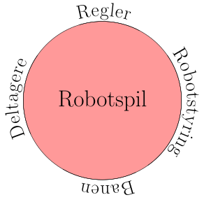

# Robotspilhjulet

I dette afsnit vil vi introducere robotspilhjulet[^note]. Tanken bag robotspilhjulet er, at når vi designer et spil, så er der nogle generelle elementer, der går igen fra spil til spil.

Vi ønsker for eksempel at designe robotslalom, så er der nogle ting vi skal forholde os til. For eksempel, hvordan skal robotterne styres? Hvordan Skal banen se ud (hvis der skal være en bane)? Hvilke regler er der? Hvad med deltagerne, skal de køre på samme tid eller hver for sig?

Vi kan stille en lang række spørgsmål, men overordnet kan spørgsmålene placeres i fire kategorier. Robotspilhjulet ser således ud

Ideen med robotspilhjulet er, at vi begynder et sted på cirklen, og så stiller vi os selv spørgsmål. Svarene på spørgsmålene er de designvalg vi træffer.

## Et eksempel

Hvis vi tager robotslalom, så kunne vi stille følgende spørgsmål:

**Robotstyring**
* Skal deltagerne programmere robotten?
* Skal deltagerne fjernstyre en programmeret robot?
* Hvis robotten er fjernstyret, hvordan sikres det, at robotten opfører sig fornuftigt?

**Banen**
* Skal banen kræve, at der køres forsigtigt?
* Skal banen tillade flere at køre samtidig?
* Skal der kunne køres hurtigt på banen?
* Skal der være mange forhindringer?

**Deltagerne**
* Hvem skal deltage?
* Hvilke forudsætninger skal deltagerne have?
* Er det en holdsport?
* Må deltagerne ændre på robotten?

**Regler**
* Tages der tid, eller er det hvem, der kommer først?
* Hvad må deltagerne, hvis robotten fx sidder fast?
* Er der regler for snyd?
* Er der regler for usportslig opførelse (fx at en robot kører en anden robot af banen med vilje)?

Det er tydeligt, at der er overlap mellem de forskellige kategorier. Det må der godt være, fordi formålet er sætte designovervejelser i gang. Dermed er det heller ikke en udtømt liste af spørgsmål.

I det næste afsnit ser vi kort på, hvordan designprincipper forholder sig til designhjulet.

[^note]: Ideen om robotspilhjulet er lånt fra Hans Klysner og Ole Caprani (2025): Design af robotspil med robotten micro:Maqueen, Aarhus Universitet. 